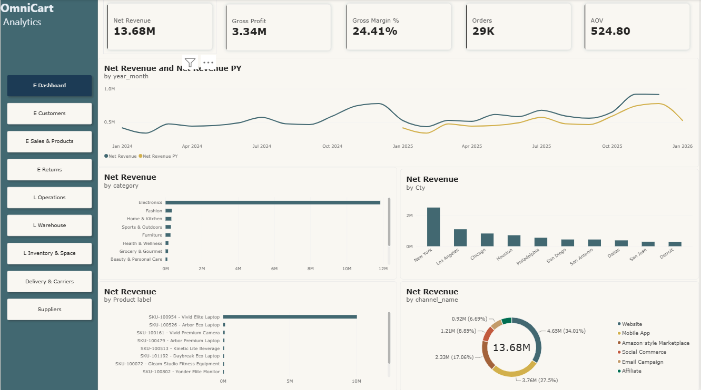
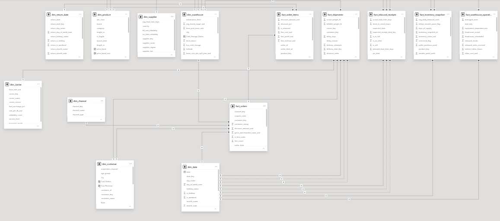
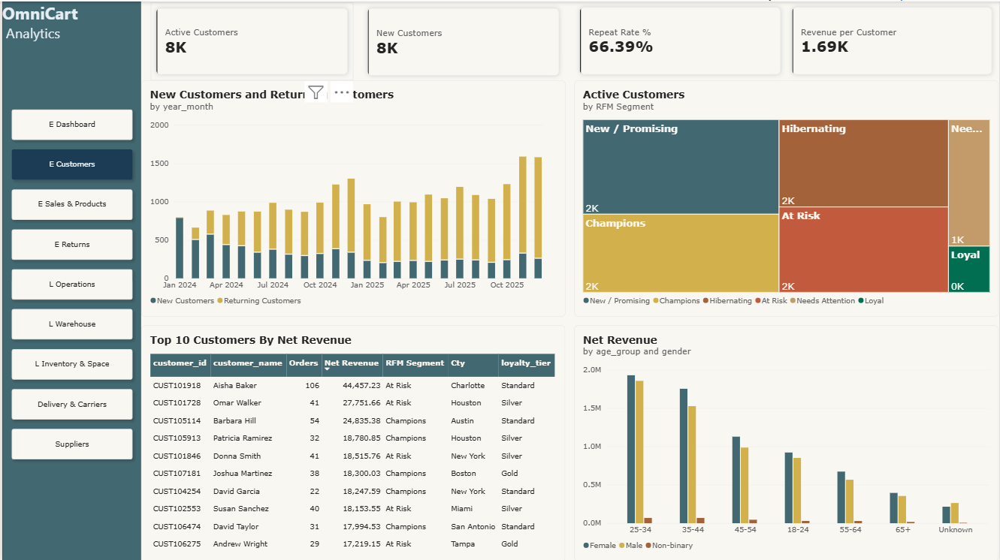
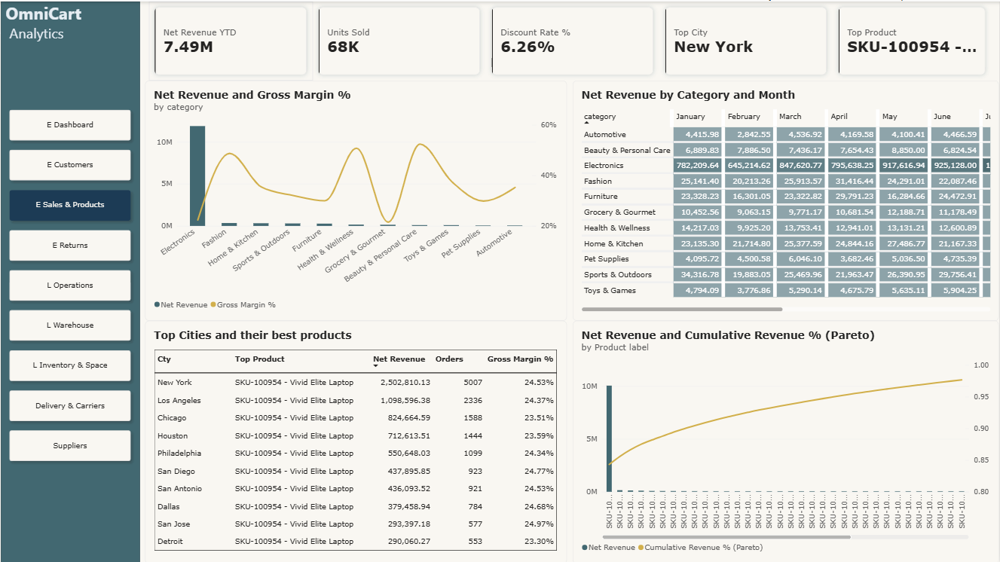
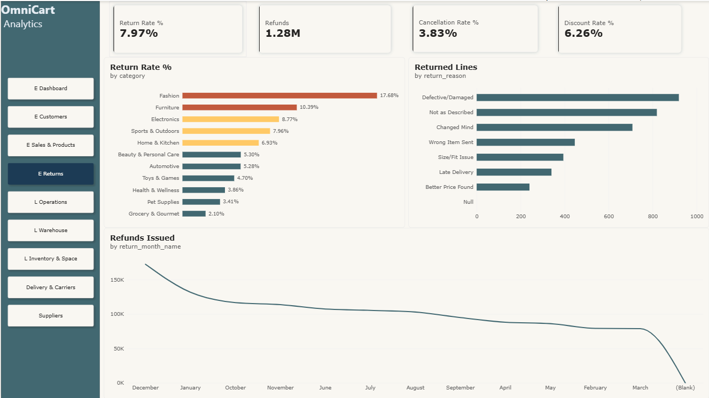
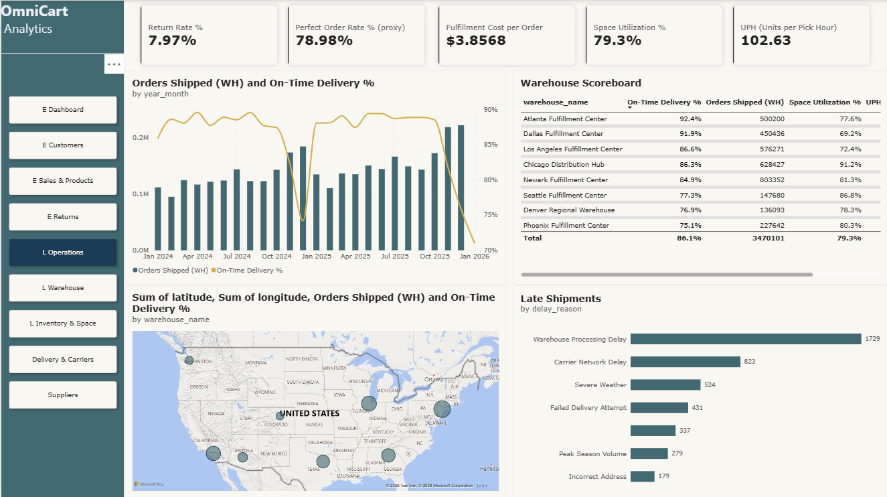
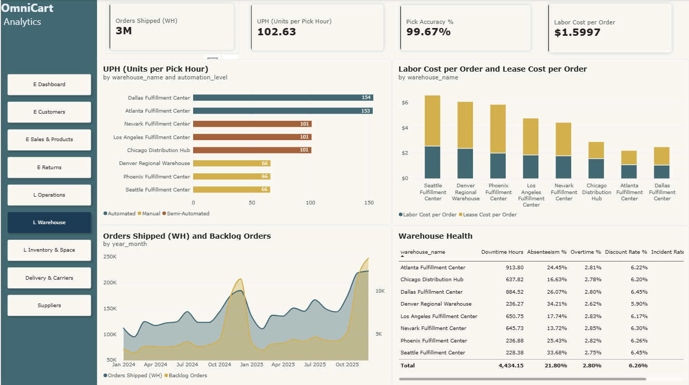
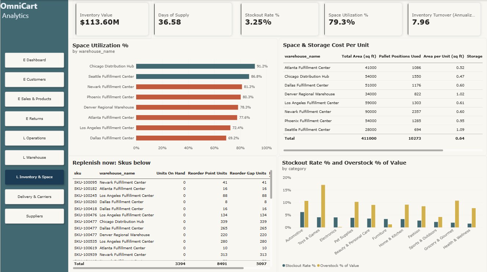
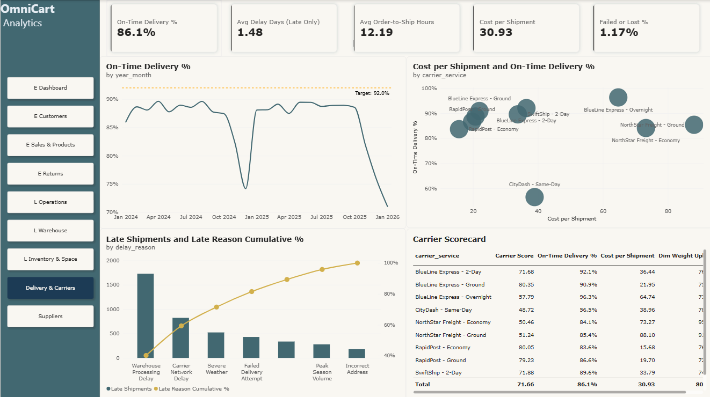
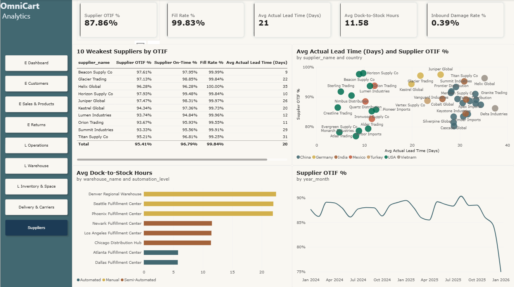

<!-- ============ TITLE ============ -->
<h1>🛒 OmniCart E-commerce &amp; Warehouse Logistics Analytics</h1>

An end-to-end data analytics project covering business requirements, loading CSV files directly into Power BI, data cleaning in Power Query, star schema data modeling and relationships in Power BI, DAX measure design, and interactive Power BI dashboards for e-commerce sales, customers, returns, warehouse operations, inventory and space utilization, delivery performance, carriers and suppliers.

  Power BIPower QueryDAX
  Star SchemaE-commerceWarehouse &amp; Logistics

<!-- EDIT: replace the image file below with your best dashboard screenshot -->

  

<!-- ============ PROJECT OVERVIEW ============ -->
<h2>📌 Project Overview</h2>

OmniCart is a fictional online retailer that ships from 8 fulfillment warehouses. The goal of this project is to answer one question a COO would ask:

<blockquote>
<em>“Between a customer clicking Buy and the parcel reaching their door, where are we losing money, time or customers?”</em>
</blockquote>

I loaded 13 CSV files (6 fact tables and 7 dimensions, about 230,000 rows) directly into Power BI, cleaned them in Power Query, built the relationships and star schema in the Power BI model view, wrote 97 DAX measures, and built a 9-page report split into two dashboards: <strong>E-commerce</strong> and <strong>Warehouse &amp; Logistics</strong>.

<!-- ============ BUSINESS QUESTIONS ============ -->
<h2>🎯 Business Questions</h2>
<h3>E-commerce</h3>
<ul>
  <li>How much revenue and profit do we earn, and is it growing year over year?</li>
  <li>Which categories, products and cities drive the most revenue and margin?</li>
  <li>Who are our best customers, and who is at risk of leaving (RFM segments)?</li>
  <li>How many customers are new versus returning?</li>
  <li>Which categories get returned most, and why?</li>
  <li>How much do discounts and refunds reduce margin?</li>
</ul>
<h3>Warehouse &amp; Logistics</h3>
<ul>
  <li>What percentage of orders are delivered on time, and what causes the delays?</li>
  <li>Which carrier service gives the best balance of cost and reliability?</li>
  <li>How productive and accurate are our warehouses (UPH, pick accuracy), and does automation pay off?</li>
  <li>What does it cost to fulfill one order at each warehouse?</li>
  <li>How full is each warehouse, and how much floor area and storage cost does each unit carry?</li>
  <li>Where do we have stockouts, overstock, and unreliable suppliers?</li>
</ul>

<!-- ============ TOOLS ============ -->
<h2>🛠 Tools &amp; Technologies</h2>
<ul>
  <li><strong>Power BI Desktop</strong>: data modeling, DAX and dashboards</li>
  <li><strong>Power Query (M)</strong>: data cleaning and transformation</li>
  <li><strong>DAX</strong>: 97 measures and 6 calculated columns</li>
  <li><strong>CSV files</strong>: 13 source tables</li>
  <li><strong>Git &amp; GitHub</strong>: version control</li>
</ul>

<!-- ============ DATASET DESIGN ============ -->
<h2>📂 Dataset</h2>

The source data is 13 CSV files: 6 fact tables and 7 dimension tables, covering January 2024 to December 2025. The files were imported directly into Power BI.

<table>
  <thead><tr><th>Table</th><th>Type</th><th>One row is…</th><th>Rows</th></tr></thead>
  <tbody>
    <tr><td><code>fact_orders</code></td><td>Fact</td><td>one customer order</td><td>30,000</td></tr>
    <tr><td><code>fact_order_items</code></td><td>Fact</td><td>one product line in an order</td><td>50,081</td></tr>
    <tr><td><code>fact_shipments</code></td><td>Fact</td><td>one shipment</td><td>28,850</td></tr>
    <tr><td><code>fact_inventory_snapshot</code></td><td>Fact</td><td>one product in one warehouse at month-end</td><td>95,376</td></tr>
    <tr><td><code>fact_inbound_receipts</code></td><td>Fact</td><td>one purchase-order line received</td><td>12,000</td></tr>
    <tr><td><code>fact_warehouse_operations</code></td><td>Fact</td><td>one warehouse, one day, one shift</td><td>11,696</td></tr>
    <tr><td><code>dim_customer</code>, <code>dim_product</code>, <code>dim_warehouse</code>, <code>dim_carrier</code>, <code>dim_supplier</code>, <code>dim_channel</code>, <code>dim_date</code></td><td>Dimensions</td><td>customers, SKUs, warehouses, carrier services, suppliers, sales channels, calendar days</td><td>12,060 / 1,200 / 8 / 10 / 40 / 6 / 762</td></tr>
  </tbody>
</table>
<ul>
  <li>Data cleaning in Power Query: removed duplicate customers, standardized city and state text, handled blank values, and added helper columns (dates, hours, lead times, product label)</li>
  <li>Order and shipment tables are a scaled sample (each order represents about 120 real orders); warehouse and inventory tables are at full network scale</li>
  <li>CSV files: <a href="data/"><code>data/</code></a></li>
</ul>

<!-- ============ DATA MODELING IN POWER BI ============ -->
<h2>🧩 Data Modeling in Power BI</h2>

After loading the CSV files into Power BI, I built the data model in the Model view: I created the relationships between the key columns and arranged the tables into a star (galaxy) schema, with six fact tables sharing conformed dimensions (date, warehouse, product, customer, carrier, supplier).

<ul>
  <li>All relationships are many-to-one with single-direction filtering, from dimension to fact</li>
  <li>The date table (<code>dim_date</code>) is marked as the date table, and a second copy is used for return dates</li>
  <li>Inactive relationships with <code>USERELATIONSHIP</code> handle promised and delivery dates</li>
  <li>All 97 measures sit in a dedicated measure table</li>
</ul>

<!-- ============ DASHBOARD ============ -->
<h2>📊 Dashboard</h2>

The report has 9 pages in two dashboards, with a left navigation menu on every page:

<table>
  <thead><tr><th>Dashboard</th><th>Page</th><th>What it shows</th></tr></thead>
  <tbody>
    <tr><td>E-commerce</td><td>E1 Dashboard</td><td>Net revenue, profit, margin, orders, top products and cities</td></tr>
    <tr><td>E-commerce</td><td>E2 Customers</td><td>New vs returning customers, RFM segments, top customers</td></tr>
    <tr><td>E-commerce</td><td>E3 Sales &amp; Products</td><td>Category margin, seasonality heatmap, Pareto, top product per city</td></tr>
    <tr><td>E-commerce</td><td>E4 Returns</td><td>Return rate, return reasons, refunds, discounts</td></tr>
    <tr><td>Warehouse &amp; Logistics</td><td>L1 Operations</td><td>On-time delivery, cost per order, UPH, space, warehouse scorecard and map</td></tr>
    <tr><td>Warehouse &amp; Logistics</td><td>L2 Warehouse</td><td>UPH, labor and lease cost, backlog, overtime, safety</td></tr>
    <tr><td>Warehouse &amp; Logistics</td><td>L3 Inventory &amp; Space</td><td>Space utilization, area and cost per unit, stockout, replenishment</td></tr>
    <tr><td>Warehouse &amp; Logistics</td><td>L4 Delivery &amp; Carriers</td><td>On-time trend, carrier scorecard, late reasons, shipping zones</td></tr>
    <tr><td>Warehouse &amp; Logistics</td><td>L5 Suppliers</td><td>Supplier OTIF, fill rate, lead time, dock-to-stock</td></tr>
  </tbody>
</table>

<h3>Screenshots</h3>
<!-- EDIT: export each report page as PNG and save with these exact names in /images -->

  <figure><figcaption>E-commerce Dashboard</figcaption></figure>
  <figure><figcaption>Customers</figcaption></figure>
  <figure><figcaption>Sales and Product Report</figcaption></figure>
  <figure><figcaption>Returns and Discounts</figcaption></figure>
  <figure><figcaption>Operations Dashboard</figcaption></figure>
  <figure><figcaption>Warehouse Operations</figcaption></figure>
  <figure><figcaption>Inventory and Space</figcaption></figure>
  <figure><figcaption>Delivery and Carriers</figcaption></figure>
  <figure><figcaption>Inbound and Suppliers</figcaption></figure>

<ul>
  <li>Power BI file: <a href="powerbi/omnicart_analytics.pbix"><code>powerbi/omnicart_analytics.pbix</code></a></li>
</ul>

<!-- ============ KEY INSIGHTS ============ -->
<!-- EDIT: these numbers were calculated from the CSV files. Re-check them against your own cards after you build the report. -->
<h2>💡 Key Insights</h2>
<ul>
  <li><strong>Revenue:</strong> Net revenue of <strong>$13.68M</strong> from <strong>28,513</strong> delivered orders (gross $14.96M less $1.28M refunds). 2025 net revenue was <strong>$7.49M</strong>, up about <strong>21%</strong> from $6.20M in 2024.</li>
  <li><strong>Category concentration:</strong> <strong>Electronics</strong> generates <strong>$11.85M</strong>, about 87% of net revenue, because of high-priced laptops, monitors and cameras. Overall gross margin is <strong>24.4%</strong>.</li>
  <li><strong>Top city:</strong> <strong>New York</strong> leads with <strong>$2.47M</strong> (about 18% of net revenue), followed by Los Angeles and Chicago.</li>
  <li><strong>Returns:</strong> <strong>8.0%</strong> of delivered units were returned; <strong>Fashion</strong> is highest at <strong>17.7%</strong>.</li>
  <li><strong>Delivery:</strong> <strong>86.1%</strong> of shipments arrived on time, but only <strong>73.3%</strong> during peak season (15 Nov to 24 Dec) versus <strong>88.5%</strong> outside it. The biggest cause of late shipments is <strong>warehouse processing delay</strong> (1,729 late shipments), ahead of carrier network delay (823).</li>
  <li><strong>Carriers:</strong> BlueLine Overnight is the most reliable (<strong>96.3%</strong> on time) but costs <strong>$64.74</strong> per shipment; CityDash Same-Day is the least reliable at <strong>56.5%</strong>.</li>
  <li><strong>Warehouse productivity:</strong> automated sites pick <strong>154</strong> units per hour versus <strong>66</strong> at manual sites (2.3x), with pick accuracy of <strong>99.82%</strong> versus <strong>99.48%</strong>.</li>
  <li><strong>Fulfillment cost:</strong> Atlanta is cheapest at <strong>$2.18</strong> per order and Seattle most expensive at <strong>$6.54</strong> (labor plus lease).</li>
  <li><strong>Space and stock:</strong> Joliet (Chicago) is the fullest warehouse at <strong>91.2%</strong> utilization in December 2025, and Phoenix peaks at <strong>95%</strong>. The overall stockout rate is <strong>2.7%</strong>.</li>
  <li><strong>Suppliers:</strong> overall on-time-in-full is <strong>87.9%</strong> against a 95% target; the weakest supplier is <strong>Atlas Trading</strong> at <strong>76.9%</strong>. Manual warehouses take <strong>22.1 hours</strong> to put goods away versus <strong>5.8 hours</strong> at automated sites.</li>
</ul>

<!-- ============ REPOSITORY STRUCTURE ============ -->
<h2>📁 Repository Structure</h2>
<pre><code>omnicart-ecommerce-logistics-analytics/
├── README.md
├── data/          → 13 source CSV files
├── powerbi/       → Power BI (.pbix)
└── images/        → Screenshots and diagrams</code></pre>

<!-- ============ HOW TO RUN ============ -->
<h2>▶️ How to Run</h2>
<ol>
  <li>Clone the repository
    <pre><code>git clone https://github.com/MAliRaja-DA/omnicart-ecommerce-logistics-analytics.git</code></pre>
  </li>
  <li>Keep the CSV files in the <code>data/</code> folder.</li>
  <li>Open the <code>.pbix</code> file in <code>powerbi/</code> with Power BI Desktop.</li>
  <li>Go to <strong>Transform data &gt; Data source settings</strong> (or edit the <code>FolderPath</code> parameter) and point it to your local <code>data/</code> folder.</li>
  <li>Click <strong>Refresh</strong>.</li>
</ol>

<!-- ============ SKILLS ============ -->
<h2>🧠 Skills Demonstrated</h2>

Power BI · Power Query (M) · DAX · Star Schema Data Modeling · Data Cleaning · KPI Design · Dashboard Design · E-commerce Analytics · Warehouse &amp; Supply Chain Analytics · Data Storytelling

<!-- ============ AUTHOR ============ -->
<h2>👤 Author</h2>

<strong>Muhammad Ali Raja</strong> 
<a href="https://www.linkedin.com/in/m-ali-raja-">LinkedIn</a> · <a href="mailto:mohammadali_raja20@outlook.com">mohammadali_raja20@outlook.com</a>

<blockquote>
All data is synthetic and created for portfolio purposes. OmniCart is a fictional company.
</blockquote>

</main>
</body>
</html>
